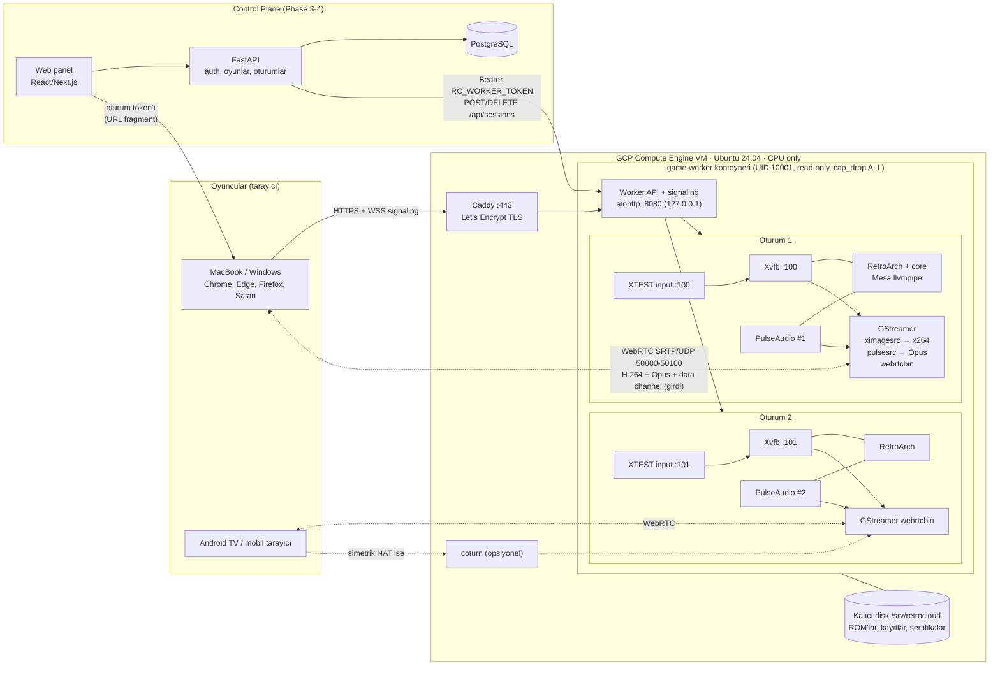
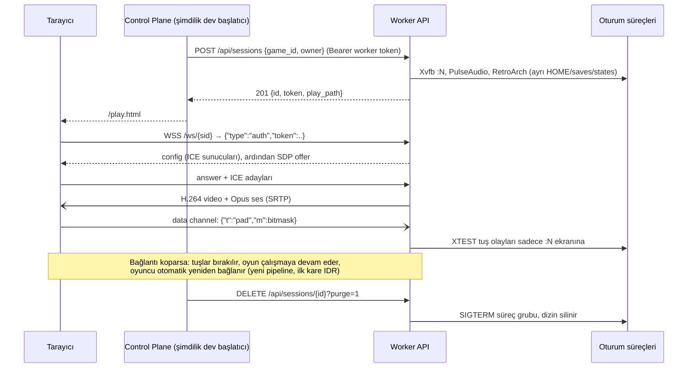

# Mimari

## 1. Genel bakış

İki katman: **Control Plane** (kullanıcılar, oyun kütüphanesi, oturum planlama; Phase 3'te FastAPI) ve **Game Worker** (oyunu çalıştırır ve yayınlar; Phase 0/1'de çalışıyor). Bugün worker kendi küçük API'si ve geliştirici başlatıcısıyla tek başına çalışıyor; Control Plane geldiğinde worker'ın `/api/*` uçlarını aynı `RC_WORKER_TOKEN` ile çağıracak. Bu yüzden worker API'si bugünden "makineden makineye" tasarlandı.



## 2. Bir oturumun hayat döngüsü



## 3. Seçilen yığın ve gerekçeleri

| Bileşen | Seçim | Neden |
|---|---|---|
| Bulut | GCP Compute Engine (Azure alternatif) | 300 USD / 90 gün kredi, Standard Tier egress'te 200 GiB ücretsiz, `max_run_duration` ile sert süre sınırı |
| VM | e2-standard-4, Ubuntu 24.04 | Phase 0'da 2 oturum ≈ 1.45 vCPU ölçüldü; 8 vCPU'ya tek değişkenle büyür |
| IaC | Terraform + cloud-init | Tek VM için Ansible gereksiz karmaşıklık; cloud-init ilk açılışı, systemd her açılışı yönetir |
| Uygulama dağıtımı | Docker Compose, host network | WebRTC'nin UDP aralığı için docker-proxy'yi atlar; worker yine de sadece 127.0.0.1'i dinler |
| TLS | Caddy + sslip.io | Gamepad API sadece güvenli bağlamda (HTTPS) çalışır; alan adı olmadan Let's Encrypt |
| Emülatör | RetroArch + libretro core'ları | Tek arayüzle NES/SNES/GB/MD/PS1; yapılandırma dosyasıyla kısayollar kapatılabiliyor |
| Rendering | Mesa llvmpipe (OpenGL 4.5, yazılımsal) | GPU yok; retro çözünürlükler için yeterli |
| Sanal ekran | Xvfb (oturum başına) | Basit, olgun, ekran = izolasyon sınırı |
| Ses | PulseAudio (oturum başına null-sink) | Ses akışları birbirinden ayrı; GStreamer `pulsesrc` monitörden okur |
| Video | x264 `ultrafast` + `zerolatency`, Constrained Baseline | Safari / Android TV uyumluluğu, düşük gecikme, B-frame yok |
| Ses kodlama | Opus 96 kbps, 10 ms çerçeve | WebRTC standardı, düşük gecikme |
| Yayın | GStreamer `webrtcbin` (1.24) | Capture → encode → RTP → DTLS/SRTP tek süreçte, C'de; Python sadece kontrol eder |
| Signaling | aiohttp WebSocket, oturum token'ı ilk mesajda | Token URL'de/loglarda görünmez |
| Girdi | Tarayıcı Gamepad API + klavye + dokunmatik → data channel → XTEST | Ayrıcalık gerektirmez, oturumlar arası sızıntı yapısal olarak imkânsız |
| Control Plane (Phase 3) | FastAPI + Pydantic + PostgreSQL | İstenen yığın; Redis sadece kuyruk/rate limit gerekince |

## 4. Güvenlik modeli

- **Kimlik**: Control Plane → worker: `RC_WORKER_TOKEN` (Bearer, sabit zamanlı karşılaştırma). Oyuncu → oturum: oturum başına 256 bit rastgele token, sadece kendi signaling soketini açar. Başka oturumun token'ı ile bağlanma denemesi 4401 ile reddedilir (test edildi).
- **Ağ**: Firewall'da sadece 22 (yönetici IP'si), 80/443 ve WebRTC UDP aralığı açık. Docker daemon hiçbir porttan açılmaz. Worker 127.0.0.1'i dinler, dışarıya Caddy üzerinden açılır.
- **Konteyner**: non-root (UID 10001), read-only root FS, `cap_drop: ALL`, `no-new-privileges`, CPU/RAM/PID limitleri. Privileged yok, `/dev/uinput` yok, `/dev/dri` yok.
- **Oturum izolasyonu**: ayrı X ekranı, ayrı PulseAudio soketi (0700 dizinde), ayrı HOME / saves / states, ayrı süreç grubu. Bir oturumun kapanması diğerini etkilemiyor (test edildi).
- **Girdi**: beyaz listeli mantıksal butonlar; RetroArch kısayolları kapalı; kopuşta tüm tuşlar bırakılır.
- **ROM yolları**: katalogdaki her yol ROM dizinine göre çözülür, `..`, mutlak yol ve dizin dışına çıkan symlink reddedilir (unit test). ROM yükleme Phase 4'e kadar yok; geldiğinde: boyut sınırı, uzantı + sihirli bayt kontrolü, rastgele dosya adı, kullanıcı başına ayrı dizin, salt-okunur bağlama.
- **TURN**: coturn `use-auth-secret` ile oturum başına süreli kimlik (TURN REST API); iç ağ adreslerine relay yasak.
- **HTTP başlıkları**: `nosniff`, `no-referrer`, `X-Frame-Options: DENY`, HSTS (Caddy).

## 5. SaaS'a hazırlık (Phase 5, şimdilik sadece tasarım)

| Konu | Plan |
|---|---|
| Multi-tenancy | `tenant_id` her tabloda; worker'lar tenant bilmez, Control Plane token'ı ve oturum sahipliğini kontrol eder |
| Worker Registry / Scheduler | Worker'lar `/health` (kapasite, boşta süre) yayınlar; scheduler en az yüklü uygun worker'ı seçer. Arayüz bugünkü worker API'si |
| GPU Worker Pool | Ayrı worker tipi (`kind: gpu`), Wolf veya Selkies tabanlı; aynı oturum API'si. GCP denemesinde GPU yok, ücretli hesap gerekir |
| Kapasite / Autoscaling | Bekleyen oturum kuyruğu + Managed Instance Group; boştaki worker'ları kapatma zaten var |
| Bölge seçimi | Tarayıcıdan worker'lara RTT ölçümü (STUN ping) → en yakın bölge |
| Kuyruk | Redis (sadece burada gerekli) |
| Ölçüm / faturalama | Oturum başlangıç/bitiş olayları → kullanım tablosu → Stripe |
| Rate limiting, audit log | API gateway katmanında; tüm yönetici işlemleri audit tablosuna |

## 6. Klasör yapısı (çalışan uygulamaya göre)

```
cloud-gaming/
├── README.md
├── docs/            feasibility, cost-analysis, architecture, deployment, roadmap, benchmark-phase0
├── infrastructure/terraform/{gcp,azure}
├── game-worker/
│   ├── worker/      config, games, session, stream, input, metrics, app
│   ├── web/         dev başlatıcı + oyuncu sayfası
│   ├── config/      games.json
│   ├── roms/testpad bu proje için yazılmış NES test ROM'u (MIT)
│   ├── tests/       pytest + Playwright uçtan uca testler
│   └── Dockerfile
├── docker/          compose.yaml, Caddyfile, env.example
├── scripts/         deploy, vm start/stop, destroy, cost_estimate, bench_encoder
├── tests/results/   Phase 0 ham ölçüm çıktıları
└── .github/workflows/ci.yml
```

`backend/` ve `frontend/` Phase 3-4'te eklenecek; şimdiden boş klasör açılmadı. Ansible da kullanılmadı (cloud-init yeterli).
